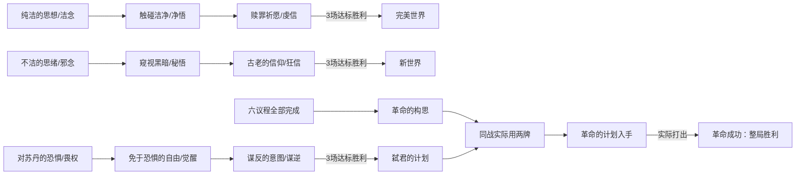

# 阿尔图Mod v0.4更新报告

日期：2026-10-10。按用户顺序先检查和验证v0.3.1增量包，再更新v0.4。目标游戏v0.111.0；BaseLib发行包manifest3.3.8、程序集3.4.7；.NET SDK9.0.318。角色和怪物ID保持兼容，PCK素材未改变。

## 第一阶段门槛

v0.3.1输入清单/基线及新增文件哈希匹配，7个补丁文件应用成功。重新编译0错误0警告；本机机制241通过/0失败，实际出牌22通过/0失败。通过后保存已验证源码ZIP，才进行v0.4。详情见[v0.3.1本机复核](v0.3.1本机复核.md)。历史输入报告没有代替本机复测。

## 源码审计差异矩阵

| 项目 | 审计分类 | 最终处理 |
|---|---|---|
| 旧59张普通奖励牌、16苏丹ID | 已实现且正确 | 保留旧牌和ID；普通20不变 |
| 七罕见 | 缺失需新增 | 加入真实注册和牌效，罕见28→35 |
| 十四稀有（含三阶） | 缺失/已有占位要改 | 三阶稳定ID替换效果，其余新增，稀有11→25 |
| 最终先古、构思、计划 | 已有占位要改 | 原ID补齐；不进普通奖励/变化/一般生成 |
| 罪证 | 已有但要改 | 替换3层，新增5～8，8替代6晕眩 |
| 苏丹之怒/嘲弄、银罚、代价及加法重放 | 已实现且正确 | 保留并回归，取消错误文档状态 |
| 字条和议程 | 已有但要改 | 能力/无消耗、七完成旗标、六任务及追加效果 |
| 革命终局 | 已有但要改/需核实API | 同战实际使用两牌发计划；原生整局胜利+原创文字+历史徽章 |
| 两革命事件+三隐藏选项 | 缺失需新增 | 第二/三幕有字条门槛，原事件选项保留 |
| 群龙无首三同名进化 | 已有但要改 | 原来只含一/二阶；扩展三阶，不再收窄 |
| 旧遗物选择界面 | 扩展审计发现实现缺陷 | 原来直接new已注册CardModel导致DuplicateModelException；改为ModelDb.ToMutable工厂，新增独立实例/原生选牌检查。与v0.3.1三项修复无关，列为v0.4审计修复 |
| 贝姬/圆桌、人数伤害奖励 | 保留并需联机验收 | 原机制命令回归；真实双客户端仍未完成 |

## 新增

新增七罕见：知己知彼、拆东补西、罪人辩词、密使传旨、擂鼓进军、集思广益、抄写员的手稿。

新增十四稀有：赎罪祈愿、古老的信仰、谋反的意图、军队正规化、革命军校、全凭君恩、螺旋圆舞曲、洞开的思想、生命权杖、以罪谋利、破釜沉舟、地下印坊、金钱开路、王命征召。

所有新牌包含基础/升级规则及中文牌面，标签牌无升级。逐张实际生成和出牌，不是仅修改数字。真实80ID与稀有度、费用、标签及升级见[v0.4奖励池80张](v0.4奖励池80张.md)。表来自运行中ModelDb导出；机器原始记录v04-release/registered-pool.json。

两个独立事件清流交汇、苗圃的课堂；原真理石板增加誊录碑文、群龙无首增加秘密议会、审判增加保护证人。全部以永久牌组有字条判断身份；独立事件限定ActIndex1/2（玩家第二/三幕），每局一次。非字条队友路径不获得本角色的专属奖励。

## 变更及结算顺序

- 罪证门槛累计，3层只自然少抽；6首次非苏丹产生一张原生Dazed，8每次一张且不再额外执行6；≥8封顶。7层按真实使用历史第四张及之后随机弃牌。兵种伤害/格挡仍用非卡来源。
- 全凭君恩免能量和代价，原生使用系列增加1；战斗内履行状态/期限冻结，不因免费使用重置。未升级战后每个被使用的原牌实例扣一次；黄金分别推进战斗期限和回合期限，任一达到只处罚一次；黄金回合达到3时按原规则重置0，避免下一回合重复罚。升级只取消战后处罚。
- 古老信仰/新世界在原生手动苏丹系列尾部增加1/2次免代价使用，其他原系列代价正常；额外2/3HP每回合一次，不乘重放次数。新世界尾部抽2+能量1。多个来源次数相加。
- 生命权杖在需要支付每次代价时提供拒绝/替换选项，接受后该回合不能再替换；选择同步使用原生卡选择接口。御用通行、贝姬、君恩等已免代价时不浪费权杖额度。
- 螺旋圆舞曲直接额外执行下一Power的效果，不添加使用历史/实体手牌；持续Power按原实例规则添加效果。贝姬可再次扫描剩余手牌，但同回合只排队一次结束；ADGC基础不改，复制例中ADGCBF。
- 真实转化只计消耗杂兵→生成高级兵种。消耗全部兵种的破釜沉舟先快照、统一消耗并通知以战养战一次，再按原消耗层逐次伤害/格挡，新奖励兵力不再次消耗。
- 字条0费Power，双标签、Retain，无Exhaust。任务完成旗标不可反悔；立即奖励同场去重，之后战斗使用字条仍获得已解锁强化；字条与弑君的独立战后删牌条件可叠加为两次可拒绝选择。
- 构思/弑君同战实际使用，任意顺序；复制效果不算第二次实际使用。生成计划一次入手，不删原牌。

## 思潮路由

三阶进度每场最多一次，存于遗物；达到3清除永久牌组该三阶同名牌并加1对应先古。低阶既有复制/互斥/进化保留。当前每路线通过进度首次达到3授奖一次，随后从奖励重新获得同名三阶可以使用，但不会重复发最终先古；这是本次保留的去重边界。

## 持久化与去重

WitchCardBox（包括宝盒升级继承）新增SavedProperty：

| 字段 | 用途 |
|---|---|
| Crime | 永久罪证；战斗Power与事件清除同步 |
| AgendaFlags | 七位完成旗标1/2/4/8/16/32/64；全部127 |
| ReadingUses、ReadingNames | 实际读物累计次数及稳定ModelId集合，排除字条 |
| LeviesConverted | 实际转化杂兵的累计原层数 |
| Devotion、Fanaticism、Treason | 三阶跨战斗达标次数 |
| ConceptGranted、PlanGranted | 每局发放构思/计划的布尔去重 |
| RevolutionWon | 原生历史内“革命成功”原因标志 |
| ClearStreamsSeen、NurserySeen | 每独立事件每局一次 |

战斗状态使用按Player隔离的ConditionalWeakTable：实际思潮名称、苏丹类型、三阶实际使用、君恩原牌实例、同战两牌使用、字条奖励/检查界面去重。战斗开始清零。选择卡从ModelDb复制可变实例，避免不同角色共用可变字段。

革命打出调用核实过的RunManager.OnEnded(true)，保存原生胜利历史/统计并删除当前未完成局，再停止当前战斗回合，呈现原创CanvasLayer文字界面。历史给所有玩家增加ARTUMOD_REVOLUTION_SUCCESS徽章，中文名“革命成功”。不是消灭敌人冒充胜利，也不进入建筑师演出。第一幕测试是注入牌检验引擎；正常字条仍来自第二幕欧洛巴斯。

## 验证证据

| 阶段/范围 | 通过/失败 | 记录 |
|---|---|---|
| v0.3.1本机机制 | 241/0 | v031-local/runtime.json、smoke.log |
| v0.3.1本机原生出牌 | 22/0 | v031-live-local/result.json、game.log、plays.json |
| v0.4最终机制与人数命令 | 393/0 | v04-release/runtime.json、smoke.log |
| v0.4新21牌及第二幕完整流程 | 85/0 | v04-live-complete/result.json、game.log、plays.json、history.json |
| v0.4第一幕结局 | 3/0 | v04-end-act1-final/result.json、history.json |
| v0.4第三幕结局 | 3/0 | v04-end-act3/result.json、history.json |
| v0.4旧22实机场景复测 | 22/0 | v04-legacy-live/result.json |

机制使用实际游戏程序集、原生Power/Creature/CardPile命令并断言数值。三阶三场条件通过独立战斗夹具检查，未宣称三场正常构筑通关。实机使用PlayCardAction和真正游戏UI；新21张逐张正常使用，测试费用替换、重放、贝姬复制、黄金冻结、罪证8、字条界面、逆序合成和原生胜利历史。事件真实打开奖励包并选择、永久入牌；广邀同道35金、传播知识30金、誊录8HP、秘密议会30金复制、保护证人30金去罪证验证通过。

开发期间新选择卡直接构造触发重复模型异常，已统一改为可变模型工厂。测试夹具曾残留初始抽牌/上一场Power，修正为原生战斗清理后再验证；没有修改生产效果来迁就测试。首轮新增奖励UI测试停在等待手动选牌，辅助程序随后改为原生选牌回调；最终85/0。中间迭代日志留在工作区开发目录，发行源码携带最终结果和第一阶段证据。

## 技术风险与真实完成范围

- **未完成真实双客户端联机**：共同结局、重新连接、各客户端任务/费用/选择一致性、圆桌协商及奖励仍待验收。1～4人数命令/共享对象测试不等于多个客户端同步；不宣称完整联机兼容。
- 人工设置2000HP、10000金币、500能量、敌人50000HP，以及6倍动画速度；功能/界面检查不是合理卡组通关或平衡证据。新事件出现概率未进行大量随机种子统计。
- 默认安装应新开一局；SavedProperty新增字段可默认读旧存档，基础序列化及稳定ID通过；未完成玩家旧存档整局续跑或带其他模组的全组合测试。
- 额外奖励使用原生奖励UI，候选筛选合法普通读物/思潮，来源可在界面与日志识别。未实测在待选奖励中断线重连；不保证该瞬间恢复自定义候选。
- 角色/怪物占位模型、符号卡图及文字结局保留；没有正式美术与音效。未复制苏丹原作美术/大段事件正文。
- Godot提前退出仍有ObjectDB/RID资源释放警告，日志完整保留；最终场景断言无失败。这些警告也出现在v0.3.1隔离退出，未据此宣称引擎日志完全无ERROR。
- Harmony补丁和结局接口针对v0.111.0。游戏/BaseLib更新后应重新编译并运行本套测试。

## 交付和迁移

安装ZIP只有ArtuMod三文件及README/本报告/卡池表；源码ZIP包含源码、设计、安装文件、原生验证辅助源码和最终日志。PCK哈希保持原资源不变；SHA256清单见release-manifest.json。源码差异见v0.4源码差异.patch和v0.4源码差异.json。游戏和BaseLib程序集、SDK、反编译源码及玩家存档均未打包。

另一台电脑要维护，请移交源码工程ZIP，设置当地GameDir/BaseLibPath，运行Build.ps1；不要要求Codex仅从安装DLL恢复工程。验证辅助模组只放隔离副本，避免改正常存档。
